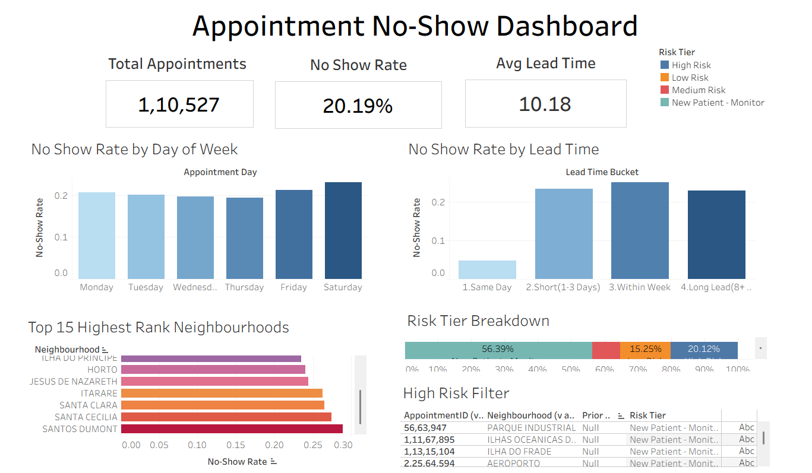

# Healthcare Appointment No-Show Analysis

End-to-end analysis of 110K+ medical appointments: SQL data cleaning, no-show driver analysis, a patient-level risk-scoring view built with window functions, and an interactive Tableau dashboard.

## Live Dashboard

[](https://public.tableau.com/app/profile/pratham.patil4988/viz/Appointmentnoshowmedicaldashboard/AppointmentNoShowDashboard)

**[Open the interactive dashboard on Tableau Public](https://public.tableau.com/app/profile/pratham.patil4988/viz/Appointmentnoshowmedicaldashboard/AppointmentNoShowDashboard)**

## Problem Statement

No-shows waste clinic slots and revenue. This project asks:

- What share of appointments end in a no-show?
- Which factors (lead time, reminders, age, day of week, neighbourhood) are linked to missed appointments?
- Can we flag high-risk appointments *before* they happen?

## Dataset

- **Source:** Medical Appointment No Shows dataset (Kaggle), file `Medical_Appointment.csv`
- **Size:** 110,521 appointments from 62,298 unique patients (after cleaning)
- **Key columns:** `PatientId`, `AppointmentID`, `ScheduledDay`, `AppointmentDay`, `Age`, `Neighbourhood`, `Scholarship`, `Hipertension`, `Diabetes`, `Alcoholism`, `Handcap`, `SMS_received`, `No-show`

## Data Cleaning

| Step | What was done |
|---|---|
| Column names | Renamed `Hipertension` to `hypertension`, `Handcap` to `disability_count`, `No-show` to `no_show` |
| Date formats | Converted ISO strings in `ScheduledDay` and `AppointmentDay` into proper `DATETIME` / `DATE` columns |
| Invalid ages | Removed rows with `Age = -1` |
| Invalid lead times | Removed rows where the appointment date was before the scheduled date |
| New feature | Added `lead_time_days` (days between scheduling and appointment) |

## Questions Answered

1. Overall no-show rate
2. No-show rate by day of week
3. No-show rate by lead-time bucket (same day, 1-3 days, 4-7 days, 8+ days)
4. No-show rate by age group (child, teen, young adult, adult, senior)
5. Do SMS reminders reduce no-shows?
6. Top 15 highest-risk neighbourhoods (minimum 100 appointments)

## Key Findings

| Factor | Finding |
|---|---|
| **Overall** | **20.19%** of appointments are no-shows (22,314 of 110,521), about 1 in 5 |
| **Lead time** | Strongest driver. No-show rate rises from **4.65%** (same day) to 22.89% (1-3 days), 25.20% (4-7 days) and **32.06%** (8+ days), about 7x higher for 8+ day bookings than same-day. Average lead time is about 10 days |
| **Age** | Teens (13-19) have the highest rate at **25.95%**; seniors (60+) the lowest at **15.31%** |
| **Day of week** | Weak predictor. Friday is highest (21.23%) and Thursday lowest (19.35%). Saturday (23.08%) has only 39 appointments, so it is excluded from conclusions |
| **SMS reminders** | Patients who received an SMS had a **27.57%** no-show rate vs **16.70%** for those who did not. This is probably confounded by lead time, since reminders are mostly sent for appointments booked further ahead |
| **Neighbourhood** | Highest rate: **Santos Dumont** (28.92%). Itarare (26.27%) has the most appointments among the top-ranked areas (3,514). Rates among the top 15 range from 22.28% to 28.92% |
| **Patient history** | 56% of appointments are a patient's first, so no history is available. Among returning patients, those with a prior no-show rate of 50% or more had a **33.43%** no-show rate vs **17.28%** for those under 20% |

**Caveats:** all findings are associations, not causes. Same-day appointments are often urgent visits, and the lead-time effect may partly explain the SMS and neighbourhood results.

## Dashboard Insights

The Tableau dashboard is built on the `v_appointment_risk` view joined with the appointment data, and contains:

- **KPI cards:** total appointments, overall no-show rate (20.19%), average lead time (10.18 days)
- **No-show rate by day of week:** nearly flat across weekdays (roughly 19% to 21%), confirming day of week is a weak signal
- **No-show rate by lead time:** a sharp jump from about 5% for same-day appointments to 23-32% for anything booked ahead, making lead time the clearest driver
- **Top 15 neighbourhoods:** ranked by no-show rate, led by Santos Dumont, Santa Cecilia and Santa Clara
- **Risk tier breakdown:** 56.4% New Patient - Monitor, 20.1% High Risk, 15.3% Low Risk and about 8.2% Medium Risk
- **High Risk filter:** a drill-down table of appointments by neighbourhood and risk tier, for building a call list

**What this means for a clinic:**
1. **Target long-lead bookings.** Appointments booked 8+ days ahead are the biggest source of no-shows, so confirmation calls or rebooking prompts should focus there.
2. **Use patient history.** Patients who frequently missed earlier appointments are about twice as likely to miss the next one.
3. **Prioritise by volume, not just rate.** High-volume neighbourhoods like Itarare produce more missed slots than small areas with higher rates.

### Calculated fields

- `No-Show Rate = SUM(IF [No-show]="Yes" THEN 1 ELSE 0 END) / COUNT([No-show])`
- `Lead Time Bucket`: groups `lead_time_days` into Same Day, 1-3, 4-7 and 8+ days

## Patient-Level Risk Scoring

The view `v_appointment_risk` uses a CTE and window functions to compute, for each appointment, the patient's **prior appointments** and **prior no-shows** (using `ROWS BETWEEN UNBOUNDED PRECEDING AND 1 PRECEDING` so the current appointment never leaks into its own score). Ties on the same appointment day are broken by `AppointmentID`. It then assigns a tier:

| Tier | Rule |
|---|---|
| New Patient - Monitor | No prior appointments |
| High Risk | Prior no-show rate >= 50% **or** lead time >= 8 days |
| Medium Risk | Prior no-show rate >= 20% **or** lead time of 4-7 days |
| Low Risk | Everything else |

The thresholds were checked against observed outcomes: longer lead times and higher prior no-show rates both corresponded to higher no-show rates.

**Limitation:** the New Patient rule is checked first, so a first-time patient booked 8+ days ahead is labelled "Monitor" and not "High Risk", even though that lead-time group has a 32% no-show rate. Reordering the rules is a planned improvement.

## Tech Stack

- MySQL (DDL/DML, `STR_TO_DATE`, `DATEDIFF`)
- Window functions (`RANK`, `COUNT/SUM OVER`), CTEs, views
- Tableau Public (calculated fields, dashboard filters)

## Repository Structure

```
.
├── README.md
├── data/
│   └── Medical_Appointment.csv
├── sql/
│   ├── Query.sql
├── dashboards/
│   └── Appointment_no_show_medical_dashboard.twb
└── images/
    └── dashboard.png
```

## How to Run

1. Create the database: `CREATE DATABASE healthcare_analytics;`
2. Import `Medical_Appointment.csv` into a table named `medicalappointment` (MySQL Workbench: Table Data Import Wizard).
3. Run the scripts in order:
   - `sql/01_cleaning.sql`
   - `sql/02_exploration.sql`
   - `sql/03_risk_scoring_view.sql`
4. Query the view: `SELECT * FROM v_appointment_risk WHERE risk_tier = 'High Risk' LIMIT 50;`
